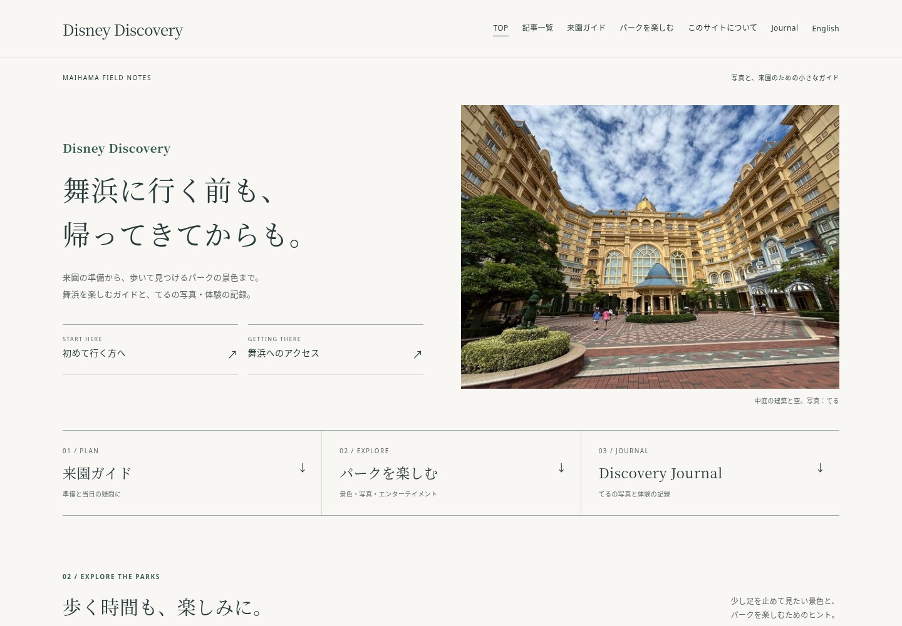
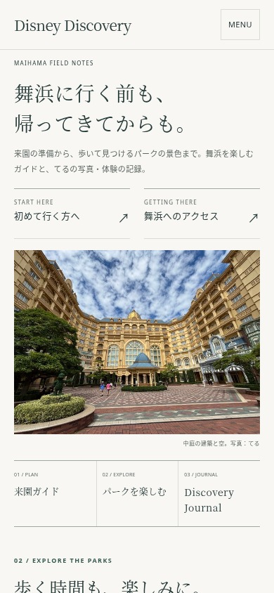

# トップ改稿・記事整理のレビュー資料

main `4e51382`、PR #83初版 `64e0531`、AGENTS.md、AI_GOVERNANCE.md、初回の差分・棚卸しを確認し、同じ作業ブランチ `prototype/photo-magazine-home` で改稿しています。mainへのマージ・本番公開は未実施です。

## 今回の変更を分けて確認

初版のあとに、次のコミットを分けています。PRのCommitsから個別に開けます。

1. **Refine magazine homepage and bring all mobile entrances forward**：トップのレイアウト調整。白に近い背景・深緑の文字・明朝の見出し・細い罫線を維持。スマホは初来園・アクセスを表紙より先に置き、３入口を横並びに。風景特集の空枠をなくし、テキストの紹介へ。
2. **Consolidate three guides and prepare eleven publication-ended notices**：公開終了・統合・内部リンク・一覧・サイトマップ・保守チェック・レビュー資料。
3. **Add metadata-free courtyard cover and photo review screenshots**：提供写真を表紙に組み込み、メタデータを除いた配信用画像、PC・スマホの写真入りスクリーンショットを追加。

## PC・スマホのスクリーンショット

ローカルChromiumの描画です。表紙に、てるが撮影して提供した中庭の写真を組み込みました。Journalの既存写真とクレジットも維持しています。

| PC 1440×1000（最初の画面） | スマホ390×844（最初の画面） |
|---|---|
|  |  |

- [PC・全体](prototype/revision-3/desktop.jpg) / [スマホ・全体](prototype/revision-3/mobile.jpg)
- 写真なしの改稿：[PC](prototype/revision-2/desktop.png) / [スマホ](prototype/revision-2/mobile.png)
- 初版の比較：[PC](prototype/desktop.png) / [スマホ](prototype/mobile.png)
- 320pxと390px幅のスマホで、写真入りの状態でも３つの入口が最初の844pxの画面に収まることを確認。初来園・アクセスは写真より先に表示しています。

## 提供写真と配信用画像

2026年11月5日、ユーザーが自分で撮影した写真として提供し、PR #83の表紙で使用することと、撮影メタデータを除去した配信用画像を作ることを指示しました。取得できた元写真は4032×3024のJPEGです。Driveの共有URL・ファイルID・撮影位置や日時は、この公開資料や画像に転記していません。原本はリポジトリに追加せず、配信用の２枚だけを追加しています。

| 配信用ファイル | 寸法 | 容量 | 用途 |
|---|---|---:|---|
| assets/img/cover-courtyard-teru-640.jpg | 640×480 | 117,231 bytes | 小さい表示幅向け |
| assets/img/cover-courtyard-teru-1280.jpg | 1280×960 | 421,529 bytes | PCや高密度ディスプレイ向け |

原本の向きを反映してsRGBに変換し、画像の画素から新しくJPEGを作成しました。EXIF/GPS、XMP、ICC/MPF、Photoshop/IPTC、コメントを引き継いでいないことを、配信する両JPEGのヘッダーで検査しています。JFIFなど画像形式に必要な情報は残ります。配信用に縮小・圧縮していますが、内容の生成・人物や建物の描き替えはしていません。写り込みは配信用画像を目視確認しました。

今回取得したのは、青空と雲、ホテルの建築、中庭を広く写した横位置の１枚です。夕景ではありません。複数候補の選定はなく、この１枚の見せ方をPC・スマホで比較しました。撮影日や正確な撮影地点を推定せず、キャプションは「中庭の建築と空。写真：てる」としています。

### PC・スマホで切り取らない表示を選んだ理由

中央の青いドームと建物、中庭、左右の建物の関係が写真の主役です。固定の低い枠で切り取ると上部の建築か下部の中庭が失われるため、PC・スマホとも元の4:3を保つ全体表示にしました。CSSはwidth:100% / height:auto / object-fit:containで、表示上の切り取りも行いません。

- PC 1440px幅：写真は約604×453px。空から園路までを見せ、中央のドームと左右の建築を保持。
- スマホ390px幅：写真は350×262.5px。160pxの固定高をやめて全体を表示。初来園・アクセス→写真→３入口の順序を維持。
- スマホ320px幅：写真は280×210px。３入口を含めて844pxの最初の画面に収まることをブラウザで確認。

srcsetで640px/1280pxを選べるようにし、画像の実寸をHTMLに指定。表紙画像は優先して読み込みます。別の写真、生成画像、切り抜きで代用していません。

風景特集の写真は足りないため、空枠は並べず、昼夜の景色とエリアの雰囲気の２つをテキストで紹介しています。Journalには元のスタンプラリー写真（900×1339）を全体表示し、「写真：てる / 2026.10.18」を維持。Journal本文は変更していません。

## 記事整理の確認先

- **[公開終了11本・統合3本のURL対応表、内部リンクへの影響、引き継いだ情報・出典、検証結果](URL_REORGANIZATION.md)**
- [URL対応表CSV](url-transitions.csv)
- 初版時点の参考：[64記事の棚卸し](HOMEPAGE_CONTENT_AUDIT.md) / [初回棚卸しCSV](article-audit.csv)。これらは初回の判断を保存した資料で、今回の公開終了対象の決定は上記URL対応表を参照してください。

公開終了11本は200＋noindexの終了案内、自動転送なし。統合3本は関係のあるガイドの該当節へmeta refreshと通常リンクで案内します。GitHub Pages上のHTTP 410・301にはしていません。旧URLのファイル自体は保持し、原本文はGitの履歴に残します。今は作業ブランチだけの変更です。

## 検証結果と未確認事項

- 静的検証：77HTML・59サイトマップURL。内部リンク・アンカー・hreflang・JSON-LD・CSPの整合で成功。
- 保護検証：有効記事50件、終了案内11件、統合転送3件。英語版・Journal・共通CSS・既存転送3件の全ファイルハッシュ一致で成功。
- URLの実動作：終了11URLと統合3URLをJavaScript有効・無効で確認。終了ページに自動転送がなく、統合は適切な該当節に到達することを確認。
- Chromium：全ページ読込、320/390/768/960/1440幅の横はみ出し、検索（日本語38件・英語12件）、キーボード・JavaScript無効・Journal導線で成功。
- 配信用２枚のJPEG：EXIF/GPS・XMPなどのメタデータがないこと、PC・スマホで写真が4:3全体表示されること、写真クレジットを検証。
- `git diff --check`：成功。公式の公演4ページと公演一覧、ランド開園日の公式ブログ、8ポートの公式ページを再確認した範囲はURL対応表に記録。

検索流入・被リンクは未確認です。初回と同様、公開トップの配信状態・実機Safari・本番のレスポンス/速度、Claudeによる独立レビューも未確認です。表紙写真の組み込みとPC・スマホ画像の更新は完了しています。公開終了と統合を実施するか、マージ・公開するかは運営者のレビュー後に判断します。
