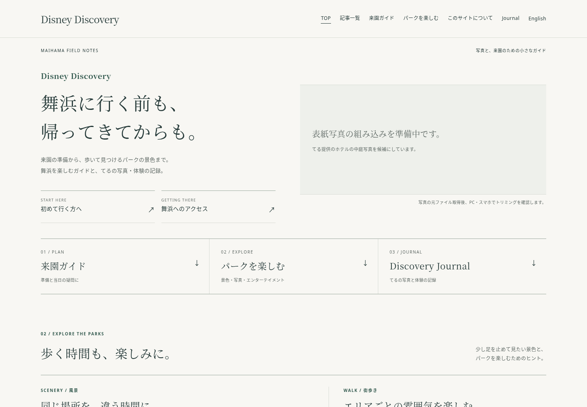
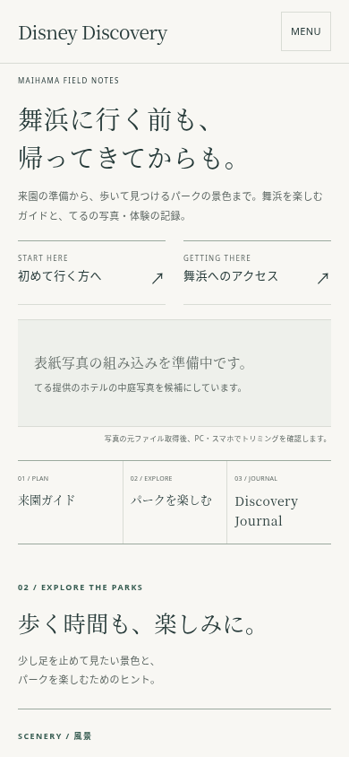

# トップ改稿・記事整理のレビュー資料

main `4e51382`、PR #83初版 `64e0531`、AGENTS.md、AI_GOVERNANCE.md、初回の差分・棚卸しを確認し、同じ作業ブランチ `prototype/photo-magazine-home` で改稿しています。mainへのマージ・本番公開は未実施です。

## 今回の変更を分けて確認

初版のあとに、次のコミットを分けています。PRのCommitsから個別に開けます。

1. **Refine magazine homepage and bring all mobile entrances forward**：トップのレイアウト調整。白に近い背景・深緑の文字・明朝の見出し・細い罫線を維持。スマホは初来園・アクセスを表紙より先に置き、３入口を横並びに。風景特集の空枠をなくし、テキストの紹介へ。
2. **Consolidate three guides and prepare eleven publication-ended notices**：公開終了・統合・内部リンク・一覧・サイトマップ・保守チェック・レビュー資料。

## PC・スマホのスクリーンショット

ローカルChromiumの描画です。**表紙の実写真はまだ組み込めていません。** Journalの写真は既存のものを読み込んでいます。

| PC 1440×1000（最初の画面） | スマホ390×844（最初の画面） |
|---|---|
|  |  |

- [PC・全体](prototype/revision-2/desktop.png) / [スマホ・全体](prototype/revision-2/mobile.png)
- 初版の比較：[PC](prototype/desktop.png) / [スマホ](prototype/mobile.png)
- 320pxと390px幅のスマホで、３つの入口が最初の844pxの画面に収まることを確認。表紙を160pxの実写真に替えた場合の最終確認は残作業です。

## 提供写真と残作業

チャットに添付された写真は、青空と雲、ホテルの建築、中庭を広く写した横位置の１枚です。夕暮れ・水辺・リゾートラインが写る写真ではありません。左右の建物と中央の建築を表紙の主役にできる候補です。ほかの候補写真は提供されていないため、複数写真の比較・選定はしていません。正確な撮影地点・撮影日は未確認です。

**添付画像は視覚的に確認できていますが、ダウンロード可能なファイルID/URLや作業環境上の元ファイルがなく、元の画像データを取得できていません。** 保存先として使える/workspace/shared/downloads等にも見つかりませんでした。元ファイル取得後、次を行う必要があります。

- ユーザー自身が撮影し表紙に使うよう指示した写真として記録。撮影日・地点を推定してキャプションに加えない。
- EXIF/GPSと写り込みを確認し、配信用の画像を用意。生成画像や似た別写真で代用しない。
- PCは3:2を基本に建物の左右と空を見せる配置、スマホは高さ160pxを上限に中央の建築を残す配置を比較。中央ドームと左右の建物を失う場合はobject-positionや高さを調整。これは**予定**で、実際のトリミング比較は未実施。
- 元ファイルを組み込み、撮影者「てる」を表示し、画像寸法・容量・PC/スマホ表示を再検証。現在の表紙部分は未組み込みを明示する案内です。

風景特集の写真は足りないため、空枠は並べず、昼夜の景色とエリアの雰囲気の２つをテキストで紹介しています。Journalには元のスタンプラリー写真（900×1339）を全体表示し、「写真：てる / 2026.10.18」を維持。Journal本文は変更していません。

## 記事整理の確認先

- **[公開終了11本・統合3本のURL対応表、内部リンクへの影響、引き継いだ情報・出典、検証結果](URL_REORGANIZATION.md)**
- [URL対応表CSV](url-transitions.csv)
- 初版時点の参考：[64記事の棚卸し](HOMEPAGE_CONTENT_AUDIT.md) / [初回棚卸しCSV](article-audit.csv)。これらは初回の判断を保存した資料で、今回の公開終了対象の決定は上記URL対応表を参照してください。

公開終了11本は200＋noindexの終了案内、自動転送なし。統合3本は関係のあるガイドの該当節へmeta refreshと通常リンクで案内します。GitHub Pages上のHTTP 410・301にはしていません。旧URLのファイル自体は保持し、原本文はGitの履歴に残します。今は作業ブランチだけの変更です。

## 検証結果と未確認事項

- 静的検証：77HTML・59サイトマップURL。内部リンク・アンカー・hreflang・JSON-LD・CSPの整合で成功。
- 保護検証：有効記事50件、終了案内11件、統合転送3件。英語版・Journal・共通CSS・既存転送3件の全ファイルハッシュ一致で成功。
- URLの実動作：終了11URLと統合3URLをJavaScript有効・無効で確認。終了ページに自動転送がなく、統合は適切な該当節に到達することを確認。
- Chromium：全ページ読込、320/390/768/960/1440幅の横はみ出し、検索（日本語38件・英語12件）、キーボード・JavaScript無効・Journal導線で成功。
- `git diff --check`：成功。公式の公演4ページと公演一覧、ランド開園日の公式ブログ、8ポートの公式ページを再確認した範囲はURL対応表に記録。

検索流入・被リンクは未確認です。初回と同様、公開トップの配信状態・実機Safari・本番のレスポンス/速度、Claudeによる独立レビューも未確認です。表紙の実写真を入れた最終画面は元ファイル取得待ちです。公開終了と統合を実施するか、マージ・公開するかは運営者のレビュー後に判断します。
