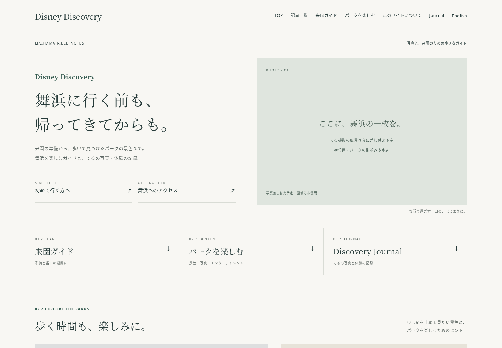
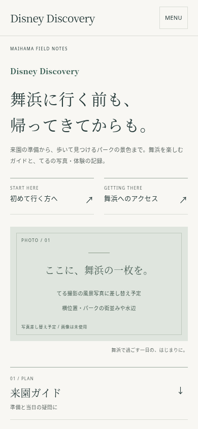

# 日本語トップの写真誌案（レビュー用）

対象：main `4e51382`。作業ブランチ：`prototype/photo-magazine-home`。本番マージ・公開は未実施。

最初の画面から「初めて行く方へ」「舞浜へのアクセス」に直接進めます。「来園ガイド」「パークを楽しむ」「Discovery Journal」の3入口を設け、下に風景特集とスタンプラリー体験を置きました。映画・キャラクターの一般読み物は主要枠から外しています。

## 表示確認

Chromiumのローカル描画です。公開サーバーのスクリーンショットではありません。

| PC 1440×1000（最初の画面） | スマホ 390×844（最初の画面） |
|---|---|
|  |  |

- [PC・ページ全体](prototype/desktop.png)
- [スマホ・ページ全体](prototype/mobile.png)
- [64記事の棚卸しと本文比較](HOMEPAGE_CONTENT_AUDIT.md)
- [棚卸しCSV（Excel向けUTF-8 BOM）](article-audit.csv)

## 写真と未確認事項

Journalのスタンプ写真は本文キャプションと運用記録で「てる撮影・2026年10月18日」を確認。元画像を維持し、全体を表示しています。舞浜の風景写真は利用根拠を確認できる素材が見つからず、カバー・夕暮れ・街並みの3枠は差し替え予定を明示しています。写真を入れたときの仕上がりは未確認です。

公開トップは取得を試みましたが取得できませんでした。最新mainのコード・Gitツリー一致まで確認していますが、公開済みのSHA・公開中の表示は未確認です。Search Console・検索流入・被リンクも未確認です。

## 変更と検証

変更は日本語トップ、トップ専用CSS、既存ブラウザテストのトップ用セレクター・配色期待値、レビュー資料のみ。記事HTML・旧URLの転送・英語版・Journal本文・共通CSS・サイトマップは最新mainと同一です。

実施結果：

- `python scripts/check_site.py`：77ページ、73サイトマップURL、内部リンク・アンカー・メタ情報・CSPの整合で成功。
- `python tests/reorganization_checks.py`：64記事URL、既存転送3件、英語本文12件の保持で成功。
- `python tests/journal_preservation.py`：本人の体験・原写真・キャプション・既存リンクの保持で成功。
- `CHROMIUM_PATH=/usr/bin/chromium python tests/browser_checks.py`：全ページのリソース読込、5幅（320/390/768/960/1440）、キーボード、検索、JavaScript無効、Journal導線で成功。
- PC・スマホの画面内に初来園・アクセスのリンクが収まり、横はみ出しがなくJournal写真が読み込まれることを確認。
- `git diff --check`：成功。

実機Safari、公開サーバーの表示・速度、最新の料金や全記事の制度・公演内容の再検証、Claudeによる独立レビューは未実施。重要な方向性の試作なので、実装レビューと運営者の判断を経てから展開を検討します。

棚卸しの統合先・保持する情報は提案です。記事統合・削除・転送追加、全ページへのデザイン展開は実施していません。
